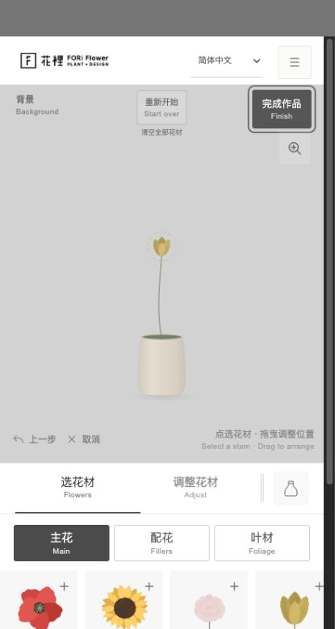

# FlowerArranging

FORi Flower 插花网站的本地前端复刻，参考：https://fori-flower-studio.com/ 。

## 在线体验

[点击体验：FlowerArranging 插花工作室](https://jdb156158.github.io/FlowerArranging/)

[](https://jdb156158.github.io/FlowerArranging/)

## 启动

```sh
npm run dev
# 或直接运行，无需安装依赖：
python3 -m http.server 5173 --bind 127.0.0.1
```

打开 http://127.0.0.1:5173 。这是原生 HTML/CSS/JavaScript 项目，无需构建。请通过 HTTP 启动，不要直接双击 HTML。

## 已保留

- 原站布局、双语文字、默认简体中文及 11 种语言选项及响应式样式。
- 62 种主花、配花和叶材，原始花材图像及矢量绘制。
- 拖拽、高度、角度、颜色、前后层级、删除、撤销和重新开始。
- 花器、花束、想象力容器、花器颜色、背景切换及画布放大。
- 贺卡文字、PNG 图片、打印用 JPG、创作回放视频和浏览器支持时的系统分享。
- 原站声音、猫咪动效、关于页面和明信片说明。
- 作品画册、48 份公开社区作品快照和 3 个小房间。

## 本地化边界

公开页面、样式、脚本和图片来自参考站 2026-09-30 快照，保留原站标识和作者信息；来源文件记录在 `reference-manifest.json`。主工作区保留原始交互实现，语言默认改为简体中文，不使用 iframe。

原站的私有投稿、审核和实时作品数据库不在公开前端内。本地作品页读取静态快照；投稿表单会明确提示未连接后台，不会向原站提交。外部官网、Instagram、打印服务链接仍指向对应官方网站。

已移除原域名的 Cloudflare 注入脚本；图片、花材、展厅背景和导出素材均本地提供。已部署到 GitHub Pages，线上地址见上方「在线体验」。

## 微信小程序：一束花（`miniprogram/`）

由网页版移植的微信小程序，目录 `miniprogram/`，用微信开发者工具「导入项目」选择该目录即可运行（appid 当前为测试号 `touristappid`，正式发布前替换为自己的 appid）。

### 功能

- 与网页版一致的插花体验：62 种花材（主花 / 配花 / 叶材）、点选 + 拖拽调整高度与倾角、换色、前后层级、移除、撤销（最多 100 步）、清空重来。
- 全部 16 种容器（标准花器 / 高脚瓶 / 马克杯 / 浅碗 / 纸包花束 / 帆布花束 / 裸花束 / 复古电视 / 贵宾犬 / 打字机）× 3 种花器颜色，细长瓶与特殊容器的瓶口裁剪、包花纸轮廓裁剪均已移植。
- 背景明暗切换、枝数统计、完成作品导出 PNG 并保存到相册。
- 界面按网页移动端布局适配：顶部操作栏 + 画布 + 底部「选花材 / 调整花材 / 容器」三面板，简体中文（附英文小字）。

### 技术实现要点

- **花材渲染**：网页版依赖 SVG 滤镜（feColorMatrix 抠绿幕 / 换色），小程序 Canvas 无法等价实现。采用「离线烘焙」：`tools/gen-flowers.js` 复用网页 `app.js` 的原始绘制函数生成全部「花材 × 花色 × 变体」SVG，`tools/rasterize.js` 用本机 Chrome（playwright-core）截成透明 PNG，`tools/process.py` 裁剪透明边、缩放、转 webp 并生成带锚点/尺寸的 `utils/manifest.js`。共 241 张图、约 1.4MB，放入 `flowerpack` 分包（单分包上限 2MB）。
- **Canvas 图片加载（关键坑）**：画布内的图片对象必须由 canvas 节点创建——`canvas.createImage()`；`wx.createImage()` 已在新版基础库（3.17+）移除，调用会报 `wx.createImage is not a function` 且花材全部不显示。
- **素材格式兜底**：默认 webp（体积小）。若个别设备 Canvas 无法解码 webp（花茎正常、花头空白），运行 `python3 tools/process.py png` 切换为量化 PNG（自动按主花/配花/叶材拆成 `flowerpack`/`flowerpack2`/`flowerpack3` 三个分包，各 <2MB），重新编译即可。
- **花茎与枝叶**：花茎贝塞尔曲线（stemGeometry）、尤加利/雪松/桦木等枝叶在小程序端用烘焙叶片零件 + Canvas 实时拼装，保留高度、弯曲、倾角的完整交互。
- **花瓶**：SVG path 全部移植为 Canvas 路径（`utils/svgpath.js` 自研 path 解释器，支持圆弧转贝塞尔），换色即时生效，无图片成本。
- **图层顺序**：背景 → 瓶影 → 瓶后层 → 花茎 → 瓶前层 → 花头，与网页版一致。
- 重新生成素材：`node tools/gen-flowers.js && node tools/rasterize.js && python3 tools/process.py`（依赖本机 Chrome 与 Pillow）；`node tools/gen-preview.js` 可生成浏览器预览页做视觉校验。

### 与网页版的差异（v1 取舍）

- 每枝花材的 ±5% 明度随机抖动（tone）未移植，花色以烘焙色为准。
- 贺卡文字、回放视频、猫咪动效、声音、多语言、作品画册未移植，小程序当前为简体中文单语。
